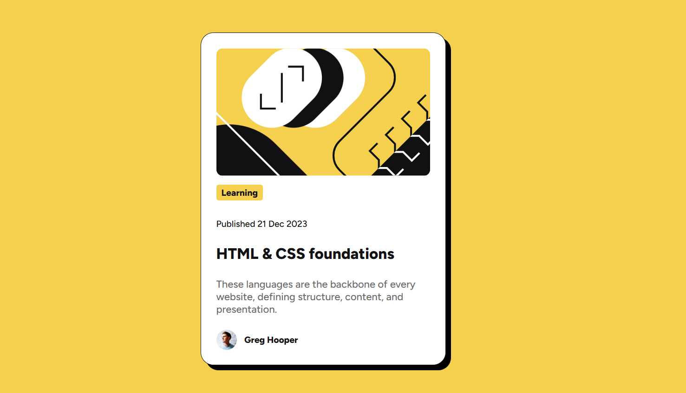

# Frontend Mentor - Blog preview card solution

This is a solution to the [Blog preview card challenge on Frontend Mentor](https://www.frontendmentor.io/challenges/blog-preview-card-ckPaj01IcS). Frontend Mentor challenges help you improve your coding skills by building realistic projects. 

## Table of contents
  - [Screenshot](#screenshot)
  - [Links](#links)
  - [My process](#my-process)
  - [Built with](#built-with)
  - [What I learned](#what-i-learned)
  - [Continued development](#continued-development)
  - [Useful resources](#useful-resources)
  - [AI Collaboration](#ai-collaboration)
  - [Author](#author)

### Screenshot

### Links

- Solution URL: [Add solution URL here](https://your-solution-url.com)
- Live Site URL: [Add live site URL here](https://your-live-site-url.com)

## My process

### Built with

- Semantic HTML5 markup
- CSS custom properties
- CSS Grid
- Custom fonts with @font-face

### What I learned

- How to read measurements in Figma and apply them in CSS
- How to load a local font with `@font-face` and `font-weight`
- How to center elements both horizontally and vertically using css grid

### Continued development

- Measuring spacing precisely in Figma (margin, padding, gap) and reproducing exactly in CSS.
- Practicing different ways to center elements, with CSS Grid, Flexbox and margin auto.

### Useful resources

- [HTML Cheat Sheet](https://htmlcheatsheet.com/) - This is an amazing article which helped me finally understand Box shadow. I'd recommend it to anyone still learning this concept.

### AI Collaboration

I used Claude to help me understand how figma works, including how to read measurements.

What works well: step-by-step explanations that I could then apply myself.
What I had to do on my own: Checking the measurements in Figma and testing every change on the browser.

## Author

- Website - [Ashly](https://portfolio-blush-gamma-73.vercel.app/)
- Frontend Mentor - [@Ashlyleila](https://www.frontendmentor.io/profile/AshlyLeila)

# Bloc-card
